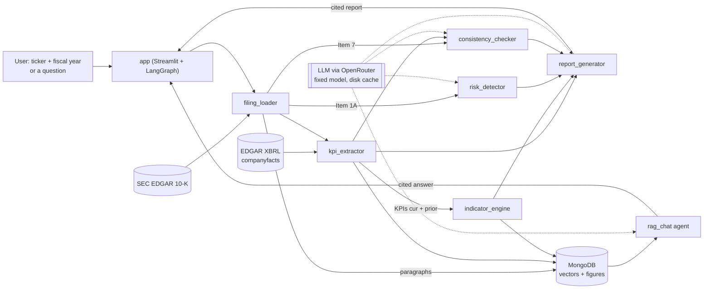
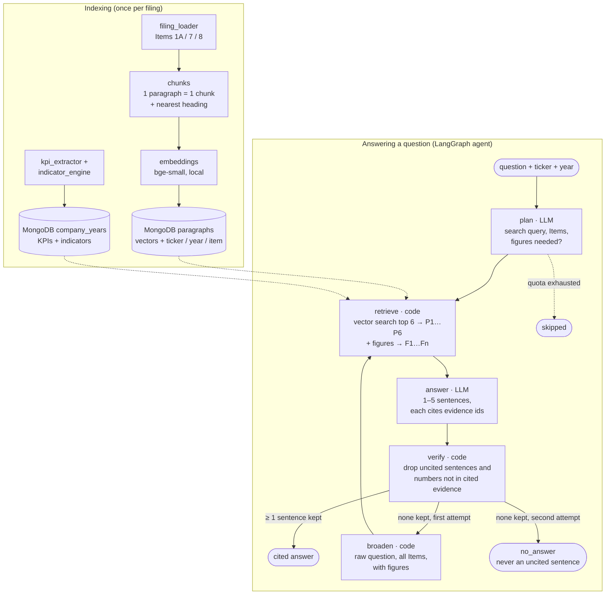

# 10-K Audit Assistant — Project Report

NLP course, Assignment 1. Code, setup and run instructions: [README.md](README.md).
Detailed logs: [docs/crisp_dm.md](docs/crisp_dm.md), [docs/decisions.md](docs/decisions.md),
[docs/architecture.md](docs/architecture.md), [docs/error_analysis.md](docs/error_analysis.md).

## 1. Task and scope

**Problem.** Reading a company's annual report (SEC Form 10-K) to judge its financial health
and spot red flags takes an auditor or analyst hours. The assistant gives a fast,
*verifiable* first pass. It is an analysis tool, not investment advice.

**Input:** a ticker and a fiscal year, or a free-text question about that filing.
**Output:** a short report where every sentence cites its source: a filing paragraph, an
XBRL fact, or an indicator computed from XBRL facts. Plus tables of KPIs, indicators, risk
paragraphs, checked MD&A claims and a chat that answers questions with citations.

**Business logic kept in scope**

| In scope | Out of scope (and why) |
|---|---|
| 5 large US companies, FY2024 (AAPL, JPM, XOM, JNJ, WMT; JPM as a bank) | Arbitrary companies at scale (rate limits, evaluation cost) |
| Items 1A (risks), 7 (MD&A), 8 (financial statements) | Other Items, exhibits, proxy statements |
| KPIs from XBRL as ground truth | LLM extraction of KPIs from text (planned, not built) |
| Ratios, growth, Altman Z'' and 8 rule-based red flags | Beneish M-score, market-price models (no price data) |
| Risk themes: 8 labels (going concern, litigation, customer concentration, debt covenants, cybersecurity, liquidity, regulatory, supply chain) + none | Fine-grained risk taxonomy, risk severity |
| MD&A claims about company totals checked against XBRL | Segment- or product-level claims (marked "unverifiable") |
| Cited summary + RAG chat over one filing | Cross-company comparison, forecasts, advice |

**Hard rule:** every generated sentence carries at least one citation. An uncited
sentence is treated as a bug and is never shown.

## 2. Data

- **Real data, nothing synthetic.** SEC EDGAR 10-K filings (inline-XBRL HTML,
  1.5–12.5 MB each) and the XBRL companyfacts API. Downloads follow the SEC fair-access
  rules: User-Agent header, ≤ 8 requests/s, raw files cached in `data/raw/`.
- **Pitfalls found by inspecting the data** (CRISP-DM Data Understanding):
  - JPM and XOM put Items 7 and 8 in a separate "Annual Report" section.
  - Companies use different XBRL tags for the same concept; WMT has no `Liabilities` tag.
  - Fiscal years differ: AAPL ends in September, WMT in January.
  - MD&A wording differs from XBRL definitions, e.g. "cash" with or without restricted
    cash or marketable securities.
- **Gold data** in [data/gold/](data/gold/README.md), committed:

  | Gold set | Size |
  |---|---|
  | filing_loader: Item boundaries | 5 filings × 3 Items |
  | indicator_engine: hand calculations | 22 values |
  | risk_detector: labeled risk paragraphs | 80, split 40 dev / 40 test |
  | consistency_checker: MD&A claims | 26 |
  | rag_chat: questions with relevant paragraphs | 30, split 10 dev / 20 test |

  Gold sets were drafted by the coding agent from inspected data and are pending human
  review (see §7).

## 3. Components



Solid arrows = data, dashed = LLM calls, cylinders = external sources / stores.

| Component | Purpose | Input → Output | Model call | External tool |
|---|---|---|---|---|
| `filing_loader` | Find the right 10-K and split it into Items with stable paragraph ids (`item_7:p12`) used as citations | ticker, FY → `Filing` | — | EDGAR HTTP |
| `kpi_extractor` | KPIs for the year and the prior year, each tied to the exact XBRL fact | `Filing` ref → `KPISet` ×2 | — | EDGAR XBRL API |
| `indicator_engine` | Ratios, growth, Altman Z'', red flags; pure functions; bank-aware | KPIs → `Indicator`s, `AnomalyFlag`s | — | — |
| `risk_detector` | Label Item 1A paragraphs by risk theme | paragraphs → `RiskPrediction`s | 1 call per 15 paragraphs | — |
| `consistency_checker` | LLM extracts numeric MD&A claims; **code** decides supported / contradicted / unverifiable | Item 7 + KPIs → `CheckResult`s | 1 call per 10 candidate paragraphs | — |
| `report_generator` | Code builds cited evidence sentences; LLM writes a 3–5 sentence summary over evidence ids; code checks faithfulness | all above → `Report` + `FaithfulnessResult` | 1 call | — |
| `rag_chat` | Answer free-text questions about the filing with citations (agentic RAG) | question → `ChatAnswer` | planner + answer (2–3) | MongoDB Vector Search; local embeddings (fastembed) |
| `app` | LangGraph orchestration with a trace span per node; Streamlit UI | user input → UI + `logs/<run_id>.jsonl` | through components | — |

**RAG chat in detail.** Indexing runs once per filing; answering is a LangGraph agent with
a verification step and one broader retry ([agent.py](src/audit_agent/rag_chat/agent.py)).



LLM calls: 2 per question, 3 with the retry. Every step writes to the run's trace.

**Why these components.** Each one answers a question an auditor actually asks: *what are
the numbers* (KPIs, from XBRL), *are they healthy* (indicators, flags), *what does
management worry about* (risks), *does management's story match the numbers*
(consistency), *what is the short version* (report), *what about X* (chat).

**Why the LLM sits where it does.** Numbers come only from XBRL and code, because the
free LLMs we tested made scale errors. The LLM does the language tasks: classifying
paragraphs, extracting claims, writing the summary, answering questions. Its output is
always checked by code afterwards.

Model: one fixed free model (`llm.model` in [config/settings.yaml](config/settings.yaml)),
temperature 0, fixed seed, every answer cached on disk so reruns are reproducible.

## 4. Walkthrough: one input through the system

Input: **AAPL, fiscal year 2024**, "Analyze" pressed in the app. The values below come from
a real run (all steps served from cache in ~0.2 s). The trace file for the run lists the
same steps.

1. **app → LangGraph.** `run_pipeline` builds a `StateGraph` with one node per component
   ([pipeline.py](src/audit_agent/app/pipeline.py)) and invokes it with
   `{company: AAPL, fiscal_year: 2024}`. Each node runs inside a tracer span.
2. **filing_loader** looks up Apple's CIK, picks the 10-K whose period ends in FY2024
   (period 2024-09-28, filed 2024-11-01, accession `0000320193-24-000123`), downloads it and
   splits it: Item 1A = 115 paragraphs, Item 7 = 96, Item 8 = 178, plus 39 tables.
3. **kpi_extractor** reads Apple's companyfacts and keeps facts filed in *this* 10-K:
   22 of 23 KPIs found. Example: revenue = $391.04B from
   `us-gaap:RevenueFromContractWithCustomerExcludingAssessedTax@2024-09-28`; prior year
   $383.29B from the same filing.
4. **indicator_engine** computes revenue growth +2.0%, gross margin 46.2%, net margin 24.0%,
   current ratio 0.87 and Altman Z'' 1.87 (grey zone). Two red flags fire:
   `low_liquidity` (current ratio below 1.0) and `receivables_outpace_revenue`
   (receivables +13.2% vs revenue +2.0%).
5. **risk_detector** sends the 95 Item 1A paragraphs of ≥ 25 words to the LLM in batches of
   15. Labels: regulatory 23, supply chain 19, litigation 18, cybersecurity 12, customer
   concentration 5, liquidity 2, none 42. Example: `item_1A:p6` → supply_chain.
6. **consistency_checker** picks MD&A paragraphs with a metric keyword and a number, and
   the LLM extracts 8 claims. Code verifies them:
   - 7 are **unverifiable**, e.g. "Greater China net sales decreased …". These are
     segment claims, and only company totals are checked.
   - 1 is **contradicted**: "unrestricted cash, cash equivalents and marketable securities
     … totaled $140.8 billion" vs XBRL cash $29.94B. This is a *false alarm*: the claim
     includes marketable securities, but the checker compares it with cash only. It is a
     definition mismatch, the error category described in §5.
7. **report_generator** builds 26 evidence sentences by code, each with citations, e.g.
   `E1: Revenue: $391.04B in FY2024 vs $383.29B in FY2023 (+2.0%)`, citing both XBRL facts
   and `indicator:revenue_growth`. The LLM then writes a summary that may only reference
   evidence ids:
   > Red flags include a current ratio of 0.87 and receivables growth of 13.2% outpacing
   > revenue growth of 2.0%. *[E12, E17, E18]*

   The faithfulness check (code, no LLM) passes all 30 statements: every citation resolves
   and every number appears in the cited evidence. 0 citation errors.
8. **app** shows the summary and per-section details with expandable citations, plus the
   KPI, indicator, risk, MD&A-check and trace tabs.

**Chat on the same filing.** Question: *"What does Apple say about its dependence on
outsourcing partners?"* The LangGraph agent ([agent.py](src/audit_agent/rag_chat/agent.py))
runs:

1. **plan** (LLM, JSON): search query "dependence on outsourcing partners manufacturing
   suppliers", Items 1A and 7, no financial figures needed.
2. **retrieve**: question embedding (bge-small) → MongoDB `$vectorSearch` filtered to
   AAPL / 2024 / Items 1A, 7 → top 6 paragraphs, labeled P1…P6.
3. **answer** (LLM, JSON): 4 sentences, each citing evidence ids, e.g. "Substantially all
   of its manufacturing is performed … by outsourcing partners located primarily in China
   mainland, India, …" → `item_1A:p29`.
4. **verify** (code): drops sentences with no valid citation or with numbers not in the
   cited evidence. All 4 kept. If nothing survived, the agent would retry once with the raw
   question and no Item filter, then return "no answer" — never an uncited sentence.

## 5. Evaluation

Every component has an eval script `evals/<component>/run_eval.py` writing
`results/latest.json` in one format ([evals/common.py](evals/common.py)). Run all with
`py scripts/tasks.py eval`.

| Component | Metric and why it fits | Result | Baseline / reading |
|---|---|---|---|
| filing_loader | Item boundary accuracy: wrong boundaries move every citation | **0.933** (14/15) | Only miss: JPM 1A keeps a page header as its last paragraph |
| kpi_extractor | Coverage; match with the Item 8 tables; agreement with the next year's 10-K | **0.86**; **0.989** (89/90); **1.0** (99/99) | Misses are concepts the company does not report (bank items, XOM/JNJ operating income) |
| indicator_engine | Match with hand calculations; unit tests incl. None / zero denominators | **1.0** (22/22) | Deterministic code, so this is a correctness check |
| risk_detector | Per-class P/R/F1 + **macro-F1** (classes are imbalanced, rare classes matter) | **0.675** macro-F1, 0.710 micro | TF-IDF+LogReg on 40 gold: **0.278**; on 440 LLM "silver" labels: **0.720** |
| consistency_checker | Verdict accuracy + **perturbed claims** (flipped direction, value ×0.5 / ×1.5 must become contradicted) | **0.885** (23/26); perturbed **19/19** | Always "supported" (majority) scores 0.73 on gold but catches 0/19 perturbed claims |
| report_generator | Faithfulness (all statements and LLM summary sentences), citation correctness, uncited count, planted +10% numbers caught (5 reports, 150 statements, 21 summary sentences) | **1.0** (150/150), summary **1.0** (21/21), **1.0**, **0**, **1.0** (149/149) | Check is code, not an LLM judge; no summary sentence dropped as uncited |
| rag_chat retrieval | hit@k, recall@k, MRR on 17 test questions | hit@6 **0.88**, MRR **0.64** | TF-IDF: hit@6 0.71, MRR 0.58 |
| rag_chat answers | Answered rate, faithfulness, citation correctness, uncited, cites gold evidence (20 test questions) | **1.0** (20/20), **1.0**, **1.0**, **0**, **1.0** | No retry needed; planner never fell back |
| app | End-to-end smoke test (Streamlit AppTest), traces per run | 5/5 companies render; chat tab works | No separate metric |

**What is high and what is low, and why**

- **High and trustworthy:** the deterministic parts (indicators, faithfulness and citation
  checks, perturbed-claim detection). Code checks code-built facts, so 1.0 is expected. The
  useful signal is that *planted* errors are caught (19/19 claims, 100% of +10% numbers).
- **Good but small samples:** segmentation 0.933 and chat retrieval 0.88 rest on 15
  boundaries and 17 questions. One error moves the score by 6–7 points.
- **Weakest: risk_detector, macro-F1 0.675.** The LLM over-labels: it tags themes that a
  paragraph only mentions in passing, so precision is lower than recall. Cybersecurity
  precision is 0.50. A TF-IDF model trained on the LLM's own labels reaches 0.720, because
  it smooths these extra labels. Improvements:
  - a stricter "main topic only" prompt with examples;
  - more test paragraphs for rare labels (going concern has 0 examples);
  - human-reviewed gold labels.
- **Consistency errors are definition gaps, not language errors.** All 3 gold errors,
  and the AAPL false alarm in §4, are claims that are true but use a different concept than
  our KPI (cash incl. restricted cash or marketable securities, margins on net sales). Fix:
  map more MD&A concepts to XBRL tags, or mark such claims unverifiable.
- **What the faithfulness check cannot see:** it verifies numbers and citations, not
  wording. "Revenue fell" with the right numbers would pass. A small manual review sample
  (`judge_agreement`) is planned.

Details per component: [docs/error_analysis.md](docs/error_analysis.md) and the Evaluation
section of [docs/crisp_dm.md](docs/crisp_dm.md).

## 6. How CRISP-DM was applied

CRISP-DM was applied per component, in small cycles, not once for the whole project. The
order was filing_loader → kpi_extractor → indicator_engine → risk_detector →
consistency_checker → report_generator → app → rag_chat. Each phase has a dated log in
[docs/crisp_dm.md](docs/crisp_dm.md).

| Phase | What it meant here | Example |
|---|---|---|
| Business Understanding | Which auditor question does the component answer? | Consistency checker: "does management's story match the numbers?" |
| Data Understanding | Inspect one real filing / companyfacts file before coding | Found that AAPL MD&A has no company-total claims, only segments |
| Data Preparation | Parsing, caching, gold sets | Paragraph ids as citations; 26 gold claims |
| Modeling | Prompts, rules, baselines | Tolerance = half of the last written digit ("$58.5 billion" ± $0.05B) |
| Evaluation | Run eval, record metrics, error analysis | Risk baseline comparison → over-labeling found |
| Deployment | Streamlit app, tracing, cache warm-up | `scripts/warm_cache.py` before a demo |

Non-obvious choices (18 so far) are recorded as context / decision / alternatives /
consequences in [docs/decisions.md](docs/decisions.md). Examples: the fiscal-year rule,
Altman Z'' instead of Z, JSON mode instead of tool calling.

## 7. Working with the AI coding assistant

The project was built with Claude Code. It was steered through files rather than through
repeated prompting.

**Instruction file.** [CLAUDE.md](CLAUDE.md) contains a single line, `@AGENTS.md`, so every
coding agent reads the same [AGENTS.md](AGENTS.md):
- goal and repo map;
- the CRISP-DM workflow: write Business and Data Understanding first, build one function
  plus its test at a time, then evaluate and log;
- the component build order;
- the rules and the metric for each component;
- a Definition of Done checklist.

**Rules that control code quality**, each with a mechanism behind it:

| Rule | Mechanism |
|---|---|
| No hardcoded financial numbers in `src/`; numbers only from XBRL or code | Hand-calculated values allowed only in `tests/` and `data/gold/` |
| Every generated statement has ≥ 1 citation | Pydantic `CitedStatement` requires `citations` with `min_length=1` |
| Model name only from config; all calls through `LLMClient` (cached, temperature 0) | Callers cannot pass a model; changing it requires a decision entry and rerunning evals |
| EDGAR only through `edgar_client` | One client enforces the User-Agent, the rate limit and the raw-download cache |
| No secrets in logs or commits | `.env` is gitignored; the tracer redacts secret-looking keys |
| Type hints, small functions, pydantic between components, no I/O in `indicator_engine` | ruff (`E, F, W, I, B, UP, N, SIM, ANN`) |
| A component is not done without tests and an eval | `make lint test` must pass (171 tests); every eval has `main()`; every component docstring states purpose / input / output / model / tool / eval (enforced by a test) |

**Skills** in [.claude/skills/](.claude/skills/), loaded only when relevant:
- `edgar-fetch`: headers, rate limits, picking the right 10-K and XBRL facts;
- `add-component-eval`: eval template, results format, baseline rules;
- `crisp-dm-log`: how to log each phase;
- `error-analysis`: sample failures, group them into categories, propose fixes.

**What goes into the agent's context:** the instruction file, the relevant skill, the
component's docstring and a sample of real data. The docs are read on demand, not loaded
up front.

**What goes into the runtime LLM's context:** only id-tagged evidence: numbered paragraphs,
label definitions, `E1…En` evidence sentences, `P1…P6` and `F1…Fn` in the chat. The output
is JSON that references those ids, so code can verify it.

**Reflection.**
- What worked: the rules made the agent's output checkable. Uncited or invented numbers
  are caught by code, not by reading.
- Logging decisions kept long sessions consistent.
- Looking at real data first prevented wrong assumptions (bank filings, fiscal years, MD&A
  definitions).
- What needed control: the agent drafts gold labels quickly, but they need human review.
  It also tends to report scores optimistically, so the instructions require baselines next
  to every LLM metric.

## 8. Running it

```powershell
copy .env.example .env              # EDGAR_USER_AGENT, OPENROUTER_API_KEY
py scripts/tasks.py setup
docker compose up -d                # MongoDB with Vector Search (chat only)
py scripts/build_rag_index.py       # one-off, ~10 min on CPU
py scripts/tasks.py app             # Streamlit UI
py scripts/tasks.py eval            # all evals
```

The free OpenRouter tier allows 50 requests/day. Run `py scripts/warm_cache.py` before a
demo; cached answers cost nothing.

## 9. Limitations and next steps

- **Gold sets drafted by the agent:** risk paragraphs, MD&A claims and chat questions need
  human review of at least a sample.
- **Small test sets** (40 risk paragraphs, 26 claims, 17–20 chat questions): differences of
  a few points are not significant.
- **Faithfulness is checked by code only.** All evals were rerun on 2026-11-15 (summaries
  for all 5 companies, all 20 chat questions). The check verifies citations and numbers,
  not wording, and no human or LLM-judge sample of the summaries exists yet
  (`judge_agreement` is empty).
- **Not built:** LLM KPI extraction (its metrics are empty) and the Beneish M-score.
- **Concept mismatches** between MD&A wording and XBRL tags cause false "contradicted"
  verdicts. Next: a concept map or an "unverifiable" fallback.
