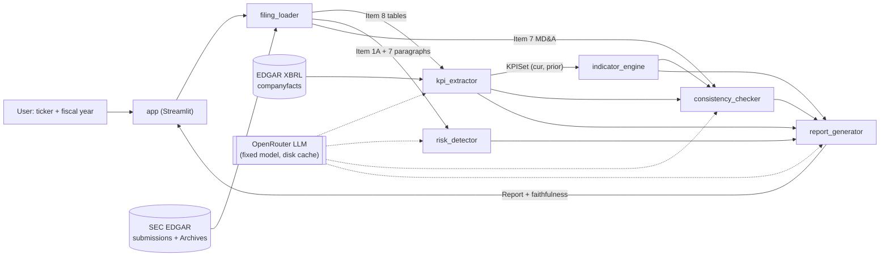

# Architecture

## Data flow

Shared infrastructure (`src/audit_agent/common/`): `config` (settings.yaml),
`llm_client` + `llm_cache`, `edgar_client` (User-Agent, rate limit, raw cache),
`tracing` (JSON lines → `logs/`), `citations` (`Citation`, `CitedStatement`).

Legend: solid = data, dashed = LLM call. Cylinders = external sources.

## filing_loader
- **Purpose:** find the 10-K for (ticker, FY), download, split into Items 1A / 7 / 8 with stable paragraph ids, extract tables.
- **Input → Output:** `(ticker, fiscal_year)` → `Filing`.
- **Model / tool:** no LLM; EDGAR HTTP.
- **Eval:** segmentation accuracy vs `data/gold/filing_loader/`.
- **Modules:** `html_blocks.py` (HTML → ordered text/table blocks), `segmenter.py` (Item
  boundaries, pointer resolution, page-furniture filter), `loader.py` (10-K selection,
  paragraphs/tables, cache in `data/processed/filings/`).
- **Status:** implemented; dev segmentation accuracy 0.933 (D-010).

## kpi_extractor
- **Purpose:** KPIs as JSON. XBRL companyfacts = ground truth; LLM reads Item 8 tables for comparison.
- **Input → Output:** `Filing` + companyfacts + KPI definitions → `KPISet`.
- **Model / tool:** LLM + EDGAR XBRL API.
- **Eval:** exact match within 0.5%; scale and sign errors separately.
- **Modules:** `xbrl.py` (fact selection by accession + period, expression parsing),
  `extractor.py` (KPI candidates in config order → `KPISet` current + prior).
- **Status:** XBRL part implemented (D-011): coverage 0.86, Item 8 table match 0.987,
  cross-filing agreement 1.0. LLM extraction pending.

## indicator_engine
- **Purpose:** growth, margins, leverage, DSO, Altman Z, Beneish M, anomaly flags.
- **Input → Output:** `KPISet` (current, prior) → `list[Indicator]`, `list[AnomalyFlag]`.
- **Model / tool:** none (pure functions).
- **Eval:** unit tests vs hand calculations.
- **Status:** stub.

## risk_detector
- **Purpose:** multi-label risk classification of paragraphs.
- **Input → Output:** `list[Paragraph]` → `list[RiskPrediction]`.
- **Model / tool:** LLM classifier; TF-IDF + LogReg baseline (scikit-learn).
- **Eval:** per-class P/R/F1, LLM vs baseline.
- **Status:** stub.

## consistency_checker
- **Purpose:** extract MD&A claims (LLM), verify against KPIs/indicators (code).
- **Input → Output:** MD&A `Section` + `KPISet` + indicators → `list[CheckResult]`.
- **Model / tool:** LLM for extraction only.
- **Eval:** verdict accuracy incl. perturbed claims.
- **Status:** stub.

## report_generator
- **Purpose:** short cited summary + faithfulness check.
- **Input → Output:** all upstream outputs → `Report`, `FaithfulnessResult`.
- **Model / tool:** LLM.
- **Eval:** faithfulness rate, citation correctness.
- **Status:** stub.

## app
- **Purpose:** Streamlit UI; `pipeline.run_pipeline` orchestrates components with one trace span per step.
- **Input → Output:** user selection → rendered report + `logs/<run_id>.jsonl`.
- **Status:** placeholder UI.
